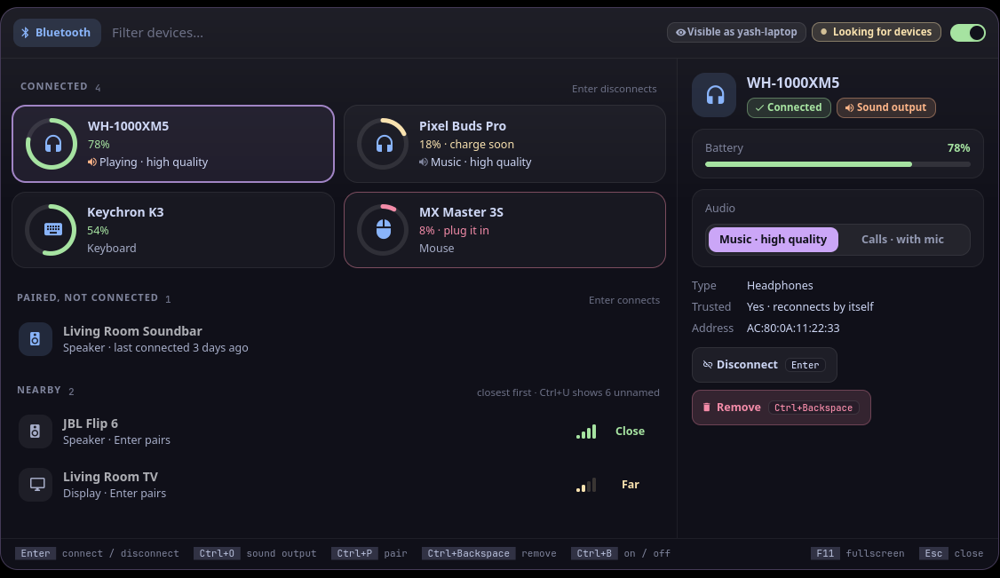
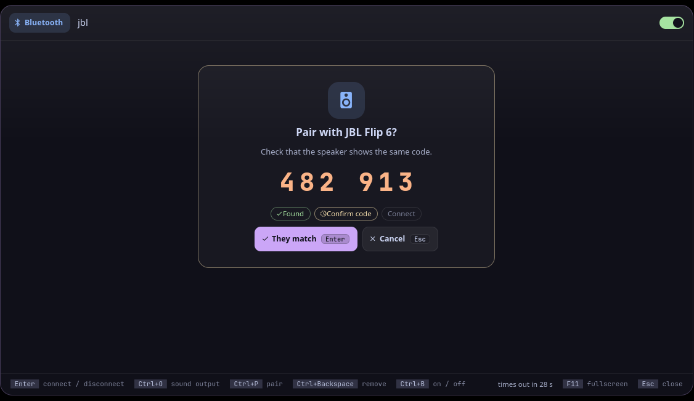

<p align="center">
  <picture>
    <source media="(prefers-color-scheme: dark)" srcset="assets/banner-dark.svg">
    <source media="(prefers-color-scheme: light)" srcset="assets/banner-light.svg">
    
  </picture>
</p>

<!-- identity -->
<p align="center">
  <b>यस्मिन्द्यौः पृथिवी चान्तरिक्षमोतं मनः सह प्राणैश्च सर्वैः ।<br>
  तमेवैकं जानथ आत्मानमन्या वाचो विमुञ्चथामृतस्यैष सेतुः ॥</b><br>
  <i>In that one, sky and earth and all between are woven: know it alone, for this is the bridge to the deathless.</i><br>
  <sub>Muṇḍaka Upaniṣad 2.2.5</sub>
</p>
<!-- /identity -->

<p align="center">
  <b>Bluetooth: connected devices as cards with battery rings, what your headphones are doing, nearby devices by distance, and pairing with the code shown big.</b><br>
  Bluetooth. A tool for <a href="https://github.com/Theyashsawarkar/vyom">Vyom</a>, keyboard-driven panels for Wayland.
</p>

<p align="center">
  <a href="https://github.com/Theyashsawarkar/setu/actions/workflows/ci.yml"></a>
  <a href="https://github.com/Theyashsawarkar/setu/releases"></a>
  <a href="LICENSE"></a>
  <a href="https://github.com/Theyashsawarkar/vyom"></a>
  
  
</p>

<p align="center">
  
</p>
<p align="center">
  
</p>
<p align="center"><sub>Screenshots use made-up demo devices.</sub></p>

> *Setu* (सेतु) is Sanskrit for "bridge": the bridge between your laptop and your Bluetooth devices.

setu is bluetooth for [Vyom](https://github.com/Theyashsawarkar/vyom): one keyboard-driven panel that opens instantly, with live data, a preview and a key for everything. It runs on any compositor with the layer-shell protocol (sway, Hyprland, river, niri, Wayfire, labwc…). In [Vayu](https://github.com/Theyashsawarkar/vayu), the desktop it was built for, it replaces bluetooth-picker.py.

## Contents

- [Features](#features)
- [Install](#install)
- [Usage](#usage)
- [Troubleshooting](#troubleshooting)
- [The Vyom family](#the-vyom-family)
- [Contributing](#contributing)
- [License](#license)

## Features

- **Connected devices are cards**, two per row, each with a **battery ring**: green, **yellow under 20%** ("charge soon"), **red under 10%** ("plug it in"). When UPower reports several batteries for one device (earbuds left, right and case), each shows on its own.
- **Headphones and speakers say what they're doing**: "Playing · high quality" (A2DP) or "Calls · with mic" (HFP/HSP), and which one is the **sound output**. In the preview, Music / Calls switches between the two (`Space v m` / `Space v c`); `Space v o` makes the selected one the sound output (through `pactl`).
- **Paired devices** that aren't connected say when they were last connected, and "Out of range" when they couldn't be reached.
- **Nearby devices, closest first**, with signal bars and a word (Close, Near, Far), found while the panel is open (the header says "Looking for devices"). Unnamed beacons hide behind `Space u h`.
- **Pairing is a step of its own**: the 6-digit code shown big, to compare with the device, with "They match" (`Enter`) or Cancel (`Esc`), and the steps Found, Confirm code, Connect. A keyboard that wants a code typed gets it shown big too.
- **Errors say why**, in plain words: "Device didn't answer: put it in pairing mode".
- "Visible as <name>" in the header: the name the other device sees.
- Remove asks first (`dd`, then `y`); an on/off switch (`Space p p`).
- **Vim keys** (Vyom 0.7): NORMAL and INSERT modes, counts, `Space` as the leader with a which-key strip, `?` for every key and `Space Space` for a palette of every action.
- No `bluetoothctl`, no Bluetooth service, no adapter, or Bluetooth off: the panel says so, and how to fix it.
- Keyboard first: every action has a key, shown on its button and in the footer; the mouse works too.
- Never freezes the panel: slow commands run in the background.

## Install

### Requirements

- [Vyom](https://github.com/Theyashsawarkar/vyom) 0.7 or newer (Python 3.11+, PyGObject, GTK 4, [gtk4-layer-shell](https://github.com/wmww/gtk4-layer-shell), a Nerd Font)
- `bluetoothctl` (BlueZ)
- Optional: `pactl` (PipeWire's pipewire-pulse, or PulseAudio) for what headphones are doing, Music / Calls and the sound output; `upower` for devices with several batteries

### Install

```sh
git clone https://github.com/Theyashsawarkar/setu ~/.local/share/vyom/plugins/setu
vyom reload           # pick it up (or log out and in)
vyom setu            # open it; run it again to close
```

Give it a key in your compositor, e.g. sway:

```sh
bindsym $mod+<key> exec vyom setu
```

### Update and uninstall

```sh
git -C ~/.local/share/vyom/plugins/setu pull && vyom reload     # update
rm -rf ~/.local/share/vyom/plugins/setu && vyom reload          # uninstall
```

## Usage

Open it with `vyom setu` (or your key). It opens in NORMAL mode, where every letter is a key and typing changes nothing: `j` / `k` move, `Enter` connects or disconnects, `dd` removes (it asks), `/` types a filter (INSERT mode; `Esc` goes back). `Space` is the leader: wait a moment after it and a strip shows what comes next. While a pairing runs, only `Enter` (they match / try again) and `Esc` (cancel) work.

<!-- KEYS (generated by scripts/keybinds.py from setu/vim.py) -->

Vyom's vim keys work too: `?` and `Space ?` list every key, `Space Space` is the palette, `q` closes, `Esc` steps back, `Space u f` is fullscreen, `Space r` refreshes, `j` / `k` move, `gg` / `G` jump, `/` searches.

**Normal mode (where it opens; `/` types a filter)**

| Key | Action |
|---|---|
| `Enter` | Connect or disconnect the selected device (pairs a new one) |
| `d d` | Remove (unpair) the selected device (y confirms) |
| `r` | Rescan for devices now |

**Leader (Space)**

| Key | Action |
|---|---|
| `Space p p` | Toggle Bluetooth on or off |
| `Space a a` | Start pairing with the selected device, then connect it |
| `Space a p` | Start pairing with the selected device (pair and trust, without connecting) |
| `Space c c` | Connect the selected device |
| `Space c d` | Disconnect the selected device |
| `Space v o` | Set the selected headphones or speaker as the sound output |
| `Space v m` | Switch the selected headphones to music (high quality, no mic) |
| `Space v c` | Switch the selected headphones to calls (with the mic) |
| `Space u h` | Toggle unnamed nearby devices (show or hide them) |
| `Space y a` | Copy the selected device's address |
| `Space d d` | Remove (unpair) the selected device (y confirms) |

**While pairing**

| Key | Action |
|---|---|
| `Enter` | Confirm the pairing code matches (or try again after an error) |
| `Esc` | Cancel pairing |

Keys that moved in this release still say where they went:
`Ctrl+Backspace` → `d d`.

<!-- END KEYS -->

## Troubleshooting

- **Nothing opens.** `vyom list` shows every installed tool, and why one is skipped (a missing requirement, or a Vyom that's too old).
- **It opened, then something failed.** Look for a `Traceback` in the daemon's log, `journalctl --user -u vyom -u vyom-daemon -b` (without systemd: `~/.local/state/vyom/daemon.log`), and [open an issue](https://github.com/Theyashsawarkar/setu/issues/new/choose) with it.
- **Pairing fails with "Device didn't answer".** Put the device in pairing mode (often: hold its Bluetooth or power button until a light flashes) and keep it close, then `Enter` to try again.
- **No Music / Calls switch.** That needs `pactl` (install pipewire-pulse) and an audio device that offers both.
- **No blur or rounded corners.** That's the compositor: on SwayFX, add `layer_effects "vyom" { blur enable; corner_radius 20; shadows enable }`.

## The Vyom family

Each tool is its own repository, so you install only the ones you want:

| Tool | | What it does |
|---|---|---|
| [dvara](https://github.com/Theyashsawarkar/dvara) | द्वार, gateway | The app launcher |
| [ganit](https://github.com/Theyashsawarkar/ganit) | गणित, mathematics | The calculator and converter |
| [smriti](https://github.com/Theyashsawarkar/smriti) | स्मृति, memory | Clipboard history |
| [bhava](https://github.com/Theyashsawarkar/bhava) | भाव, feeling, emotion | The emoji picker |
| [tarang](https://github.com/Theyashsawarkar/tarang) | तरंग, wave | Wi‑Fi and the hotspot |
| [setu](https://github.com/Theyashsawarkar/setu) (this one) | सेतु, bridge | Bluetooth |
| [doot](https://github.com/Theyashsawarkar/doot) | दूत, messenger | Your phone, through KDE Connect |
| [patra](https://github.com/Theyashsawarkar/patra) | पात्र, vessel | Docker containers |
| [akashvani](https://github.com/Theyashsawarkar/akashvani) | आकाशवाणी, voice from the sky | Notifications |
| [raga](https://github.com/Theyashsawarkar/raga) | राग, melody | YouTube music and video |
| [mudra](https://github.com/Theyashsawarkar/mudra) | मुद्रा, gesture | Keybinding search |
| [urja](https://github.com/Theyashsawarkar/urja) | ऊर्जा, energy | The battery at a glance |
| [vishram](https://github.com/Theyashsawarkar/vishram) | विश्राम, rest | The power menu |
| [kendra](https://github.com/Theyashsawarkar/kendra) | केन्द्र, centre | Quick settings |

## Contributing

Bug reports, ideas and pull requests are welcome: see [CONTRIBUTING.md](CONTRIBUTING.md) for the development setup and the few rules every tool follows, and [CHANGELOG.md](CHANGELOG.md) for what changed in each release. Please report security issues privately ([SECURITY.md](SECURITY.md)).

## License

[MIT](LICENSE).
